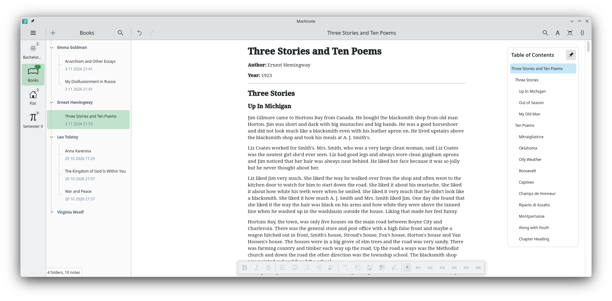
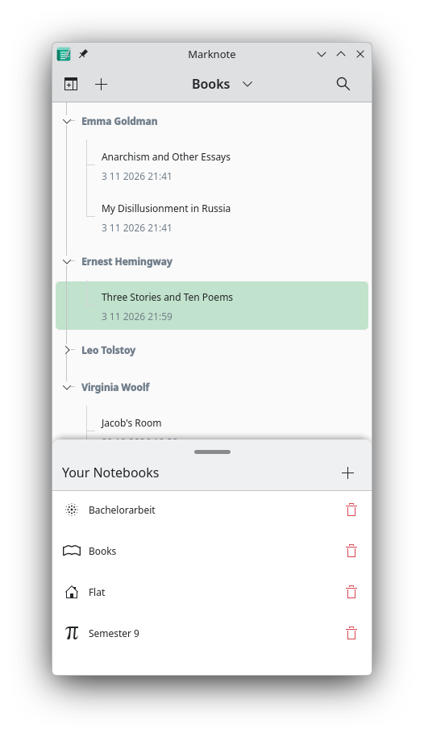

#    Marknote

Write down your thoughts.

Marknote supports a wide range of formatting options useful for taking everyday notes, like bold, italic, underlined and strike through fonts as well as headings, lists, check boxes, images and more.

 

## Installation

<a href='https://flathub.org/apps/details/org.kde.marknote'></a>

<a href='https://snapcraft.io/marknote'></a>


Nightly flatpak: [https://cdn.kde.org/flatpak/marknote-nightly/org.kde.marknote.flatpakref](https://cdn.kde.org/flatpak/marknote-nightly/org.kde.marknote.flatpakref)


## Contributing and AI
Contributors keep this project alive! We greatly appreciate any help. To make it possible for us to review your contributions properly, please respect the following guidelines:

### Merge Requests

Code contributions should be submitted through merge requests. Please clearly explain what your merge request does.

### Bug Reports

Bug reports can be submitted either on bugs.kde.org or through the work items of this repository.

### Feature Requests and Discussion

If you have great ideas, come talk to us! You can do so either through the work items or by joining our Matrix room: [#marknote:kde.org](https://matrix.to/#/#marknote:kde.org).

### AI

The use of "AI" for contributions is strongly discouraged. If you nevertheless choose to use "AI", please never submit code that you do not fully understand. If "AI" has been involved in your merge request or bug report, you must add the #AI-generated label.

Most "AI"-generated submissions we have received so far have been nonsensical or unnecessarily complicated. We therefore take extra precautions when reviewing "AI"-generated submissions.

## Build Instructions

### flatpak builder (with kde sdk)
```
flatpak-builder tmp --force-clean --ccache --install --user org.kde.marknote.json
```
### cmake
```
mkdir build
cd build
cmake ..
make
```
### kdesrc-build
```
kdesrc-build marknote
```

### Nix
#### Dev path:
```
nix develop
cmake -B build -G Ninja -DCMAKE_BUILD_TYPE=Debug
cmake --build build
./build/bin/marknote
```
#### Package path:
```
nix build .#marknote
./result/bin/Marknote
```

