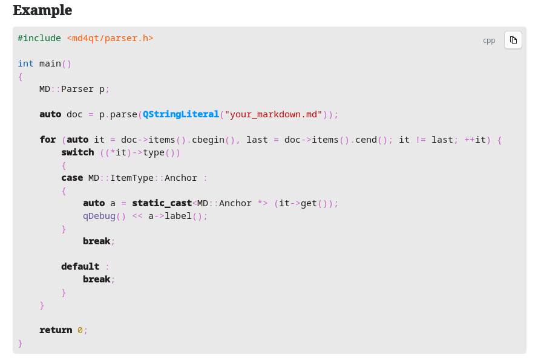
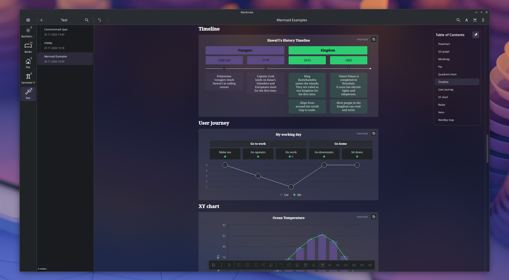
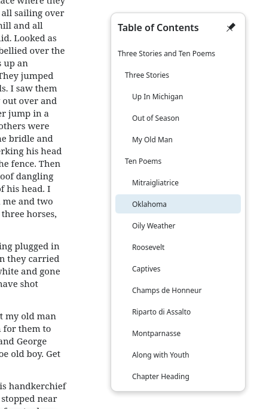
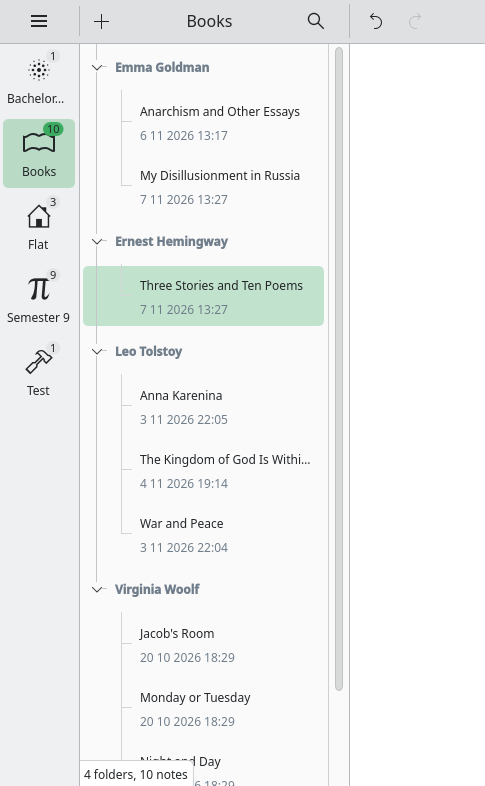
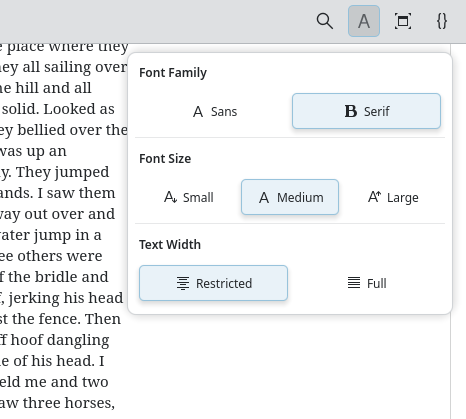

<!--
	SPDX-FileCopyrightText: 2026 Mathis Brüchert <mbb@kaidan.im>
	SPDX-License-Identifier: CC-BY-SA-4.0
-->

# Marknote 1.7 - The Editor Update

We have been working on the next release of Marknote for a few month now, and are happy to announce what might be our biggest update yet.

## The Editor

Since the last release, our GSoC contributor [Prayag Jain](https://invent.kde.org/prayag) has done amazing work in completely rewriting the rich text editor. While previously using a default QTextDocument, we now have a fully fletched block editor like you might know from applications like Notion. Each element is now its own block, allowing quick re-aranging of your notes, and more importantly gives us full control over the note rendering. For parsing the Markdown, we now use KDE's own markdown library [md4qt](https://invent.kde.org/libraries/md4qt), developed by [Igor Mironchik](https://invent.kde.org/imironchik) who has been a great help to us. Prayag also implemented a syntax highlighter, that formats the text correctly while editing a block.

For a more in depth read into how the block editor was made, we recommend Prayag's blogpost: [Meet Marknote's New Block Editor](https://prayag2.github.io/posts/marknote-block-editor/)

### Tables

Instead of fighting them, tables now offer intuitive controls for adding and editing rows and columns, and have much prettier visuals, featuring a highlighted header row.

### Nesting and Drag and Drop

The new editor offers full Markdown nesting, meaning you can have lists in quotes, code in quotes, code in lists and every possible combination of elements you can think of. We know thoughts don't work linearly, so of course you can rearrange all the elements whenever your vision evolves.

Handling the rendering ourselves, allows us to have beautifully themed quotes and native checkboxes.

### Code Blocks

Code blocks now offer syntax highlighting for most languages and allow you to quickly copy their contents.

Most recently, [Divyanshu Chandra](https://invent.kde.org/divyanshu) implemented full Mermaid diagram rendering to code blocks using the beautiful diagram rendering engine [Pele](https://pele.run/#pele-in-use) developed by [kepano](https://mastodon.social/@kepano).

Marknote now supports most Mermaid diagrams (such as flowcharts, sequence diagrams, class diagrams, pie charts, and many more) and renders them seamlessly, respecting your theme and font settings. You can access it by using the `/` shortcut menu or by creating a code block with the language set to `mermaid`.

## UI

  

A lot of polish was given to the rest of the application too: [Mathis](https://invent.kde.org/mbruchert) redesigned the Table of contents, to be quickly accessible by hovering on the side, or be pinned down next to the text, which can now be configured to be as wide or narrow as you want for easier readability.

In the last version, we started work on making it possible to sort your notes into sub folders. This is now fully working, enabling you to add folders and drag and dropping them around to your liking.

You also now have the option to quickly configure how you want your notes to look without having to go to the settings. More in depth options are still accessible in the dedicated settings window.

## Bug fixes

[Partha P. G.](https://invent.kde.org/rugbedbugg), [Divyanshu Chandra](https://invent.kde.org/divyanshu) and others have put in a lot of work to fix the many bugs that still needed to be addressed before this release:

* Notes in subfolders are now accessible from the command bar (Partha P. G.)

* Images in the editor don't get comically large anymore (Partha P. G.)

* Marknote doesn't crash anymore when moving some notes (Partha P. G.)

* You don't get stuck anymore when editing tables if they are the last block (Divyanshu Chandra)

* Notes don't get duplicated anymore when renaming the currently open one (Divyanshu Chandra)

* You can not accidentally override Notes anymore when switching between notebooks to quickly (Partha P. G.)

* and probably a lot more ...

## Contribute

This release has only been made possible by new contributors. Thank you for all of your work!

If you feel inspired, we appreciate contributions a lot:)

[https://invent.kde.org/office/marknote](https://invent.kde.org/office/marknote)
